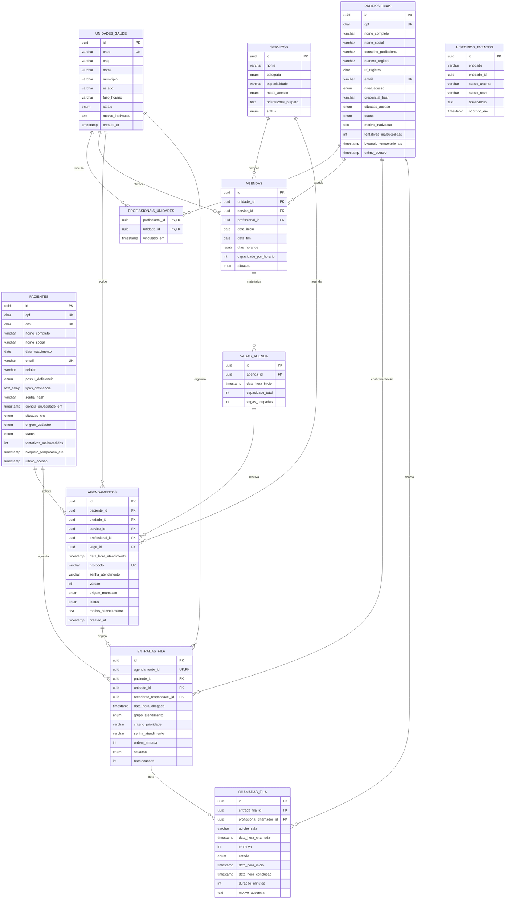
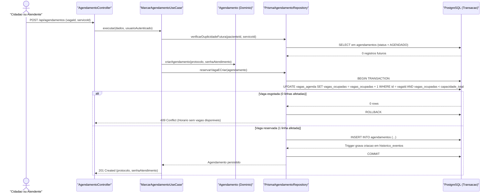
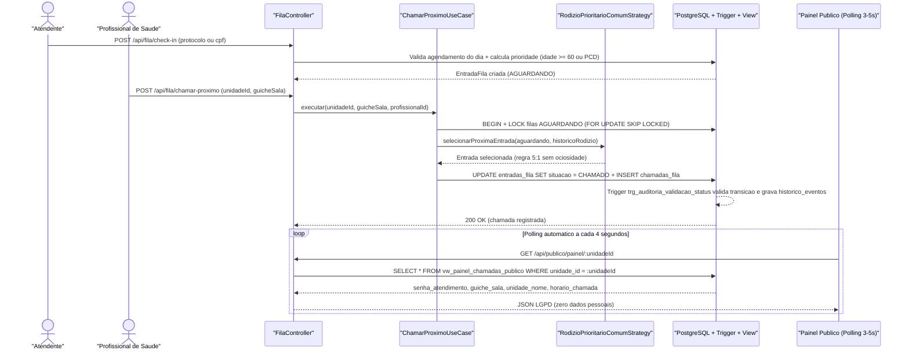

# Arquitetura do Sistema — Transparência de Filas Públicas (SUS)

## 1. Visão Arquitetural e Stack Tecnológica

O sistema adota uma arquitetura **Cliente-Servidor em Camadas**, com o backend estruturado segundo os princípios da **Programação Orientada a Objetos (POO)** e **Clean Architecture / DDD Tático simplificado**, garantindo que toda regra de negócio permaneça isolada da infraestrutura (Express e Prisma ORM).

- **Frontend (`frontend/`):** React + TypeScript (Vite), Tailwind CSS e React Router. Consome a API REST via JSON com polling automático (3–5s) nas telas de Painel Público e Acompanhamento da Fila.
- **Backend (`backend/`):** Node.js + TypeScript, Express, Zod (validação de entrada HTTP), `jsonwebtoken` (JWT), `bcryptjs` (hash de senhas) e Prisma ORM.
- **Banco de Dados (`sql/` + `backend/prisma/`):** PostgreSQL local (`filas_sus`) enriquecido com script SQL customizado (`sql/estrutura_3af.sql`) cobrindo as 4 integridades, Trigger PL/pgSQL, Índices, Roles/Grants e View LGPD.

---

## 2. Estrutura Completa de Diretórios

```text
sistema-fila-sus/
├── backend/
│   ├── prisma/
│   │   ├── schema.prisma
│   │   └── migrations/
│   ├── src/
│   │   ├── domain/
│   │   │   ├── entities/          # Usuario (abstract), Paciente, Profissional, UnidadeSaude, Servico, Agenda, VagaAgenda, Agendamento, EntradaFila, ChamadaFila
│   │   │   ├── value-objects/     # Cpf, Cns, Senha
│   │   │   ├── strategies/        # EstrategiaChamadaFila, RodizioPrioritarioComumStrategy, OrdemChegadaStrategy
│   │   │   ├── repositories/      # Interfaces I*Repository (desacopladas do Prisma)
│   │   │   └── errors/            # DomainError, ValidationError, UnauthorizedError, ConflictError
│   │   ├── application/
│   │   │   └── use-cases/         # Casos de uso orquestrando entidades, estratégias e repositórios
│   │   └── infrastructure/
│   │       ├── database/prisma/   # PrismaClient e implementações concretas Prisma*Repository
│   │       └── http/              # Controllers, middlewares (auth, role), routes, validators (Zod) e app.ts
│   └── package.json
├── frontend/
│   ├── src/
│   │   ├── components/            # Componentes reutilizáveis e layout acessível
│   │   ├── contexts/              # AuthContext (JWT e perfil ativo)
│   │   ├── pages/                 # Telas: Login, Autocadastro, Portal Cidadão, Operação Recepção/Médico, Admin, Painel Público
│   │   └── services/              # Cliente HTTP fetch/axios
│   └── package.json
├── sql/
│   └── estrutura_3af.sql          # DDL integridades, Trigger PL/pgSQL, Índices, Roles/Grants e View
├── openspec/
│   └── specs/                     # Especificações técnicas em Markdown
├── docs/
│   ├── requisitos-mvp.md
│   ├── arquitetura.md
│   └── prompts/
├── AGENTS.md
├── README.md
└── prd.md
```

---

## 3. Aplicação Explícita dos 4 Pilares de POO (AV03 — 60% da nota)

### 3.1. Abstração e Herança
- **`abstract class Usuario`** define os atributos comuns (`id`, `cpf: Cpf`, `nomeCompleto`, `nomeSocial`, `email`, `celular`, `senhaHash: Senha`, `status`, `tentativasMalsucedidas`, `bloqueioTemporarioAte`, `ultimoAcesso`) e os contratos abstratos (`obterPerfilAcesso()`, `podeAutenticar()`, `validarRegrasEspecificas()`), além dos métodos compartilhados de bloqueio de login (`registrarFalhaAutenticacao()`, `registrarSucessoAutenticacao()`, `estaBloqueado()`).
- **`class Paciente extends Usuario`** adiciona atributos clínicos/sociais (`cns: Cns`, `dataNascimento`, `possuiDeficiencia`, `tiposDeficiencia`, `situacaoCns`, `origemCadastro`, `cienciaPrivacidadeEm`) e métodos próprios (`calcularIdade()`, `ehPrioritarioLegal()`, `obterCriterioPrioridade()`, `obterNomeExibicao()`).
- **`class Profissional extends Usuario`** adiciona atributos funcionais (`conselhoProfissional`, `numeroRegistro`, `ufRegistro`, `nivelAcesso`, `situacaoAcesso`, `unidadesVinculadas`, `especialidades`) e métodos próprios (`estaVinculadoAUnidade(unidadeId)`, `podeGerenciarAgenda()`, `podeChamarFila()`).

### 3.2. Encapsulamento
- **Value Objects imutáveis:**
  - `Cpf`: remove máscara, recusa sequências repetidas (`000...` a `999...`) e valida os 2 dígitos verificadores no construtor.
  - `Cns`: valida 15 dígitos pelo algoritmo oficial do Cartão Nacional de Saúde (início `1`/`2` com módulo 11 e início `7`/`8`/`9` com ponderação 15..1).
  - `Senha`: valida comprimento (8–64), exigência de letras e números, proibição de igualdade com CPF ou data de nascimento e encapsula comparação/hash.
- **Proteção de invariantes e transições nas entidades:**
  - Atributos internos possuem visibilidade `private`/`protected` com getters controlados.
  - `Agendamento.cancelar(motivo)` bloqueia cancelamento caso já esteja `REALIZADO` ou `CANCELADO`.
  - `EntradaFila.chamar(guicheSala)`, `iniciarAtendimento()`, `concluir()`, `registrarAusencia(motivo, permitirRecolocacao)` validam o grafo de estados (`AGUARDANDO -> CHAMADO -> EM_ATENDIMENTO -> CONCLUIDO | NAO_ATENDIDO`), impedindo atribuição direta de status inválido.

### 3.3. Polimorfismo
- **Polimorfismo de Estratégia (`EstrategiaChamadaFila`):**
  - A interface `EstrategiaChamadaFila` define o contrato `selecionarProximaEntrada(aguardando: EntradaFila[], historicoRecente: HistoricoRodizio): EntradaFila | null`.
  - `RodizioPrioritarioComumStrategy` implementa o rodízio configurável **5 prioritários para 1 comum**, evitando ociosidade se o grupo prioritário ou o grupo comum estiver vazio.
  - `OrdemChegadaStrategy` implementa ordenação estritamente cronológica por `ordemEntrada` (útil em agendas/filas sem distinção de prioridade ou fallback).
- **Polimorfismo de Repositório (`I*Repository`):**
  - Os casos de uso em `application/use-cases/` dependem apenas de interfaces (`IPacienteRepository`, `IProfissionalRepository`, `IUnidadeSaudeRepository`, `IAgendaRepository`, `IAgendamentoRepository`, `IFilaRepository`, `IPainelPublicoRepository`), nunca de `PrismaClient` diretamente.

---

## 4. Diagramas Mermaid

### 4.1. Diagrama de Classes do Domínio POO (`classDiagram`)

```mermaid
classDiagram
    class Cpf {
        -string valor
        +criar(valor: string) Cpf
        +getValor() string
        +formatado() string
    }

    class Cns {
        -string valor
        +criar(valor: string) Cns
        +getValor() string
    }

    class Senha {
        -string hash
        +criarDeTextoPlano(senha: string, cpf: string, dataNascimento: Date) Senha
        +deHash(hash: string) Senha
        +comparar(senhaPlana: string) boolean
        +getHash() string
    }

    class Usuario {
        <<abstract>>
        #string id
        #Cpf cpf
        #string nomeCompleto
        #string nomeSocial
        #string email
        #string celular
        #Senha senhaHash
        #string status
        #number tentativasMalsucedidas
        #Date bloqueioTemporarioAte
        #Date ultimoAcesso
        +obterNomeExibicao() string
        +estaBloqueado(agora: Date) boolean
        +registrarFalhaAutenticacao(agora: Date) void
        +registrarSucessoAutenticacao(agora: Date) void
        +obterPerfilAcesso()* string
        +podeAutenticar()* boolean
    }

    class Paciente {
        -Cns cns
        -Date dataNascimento
        -string possuiDeficiencia
        -List~string~ tiposDeficiencia
        -string situacaoCns
        -string origemCadastro
        -Date cienciaPrivacidadeEm
        +calcularIdade(referencia: Date) number
        +ehPrioritarioLegal(referencia: Date) boolean
        +obterCriterioPrioridade(referencia: Date) string
        +obterPerfilAcesso() string
        +podeAutenticar() boolean
    }

    class Profissional {
        -string conselhoProfissional
        -string numeroRegistro
        -string ufRegistro
        -string nivelAcesso
        -string situacaoAcesso
        -List~string~ unidadesVinculadas
        -List~string~ especialidades
        +estaVinculadoAUnidade(unidadeId: string) boolean
        +podeGerenciarAgenda() boolean
        +podeChamarFila() boolean
        +obterPerfilAcesso() string
        +podeAutenticar() boolean
    }

    class UnidadeSaude {
        -string id
        -string cnes
        -string cnpj
        -string nome
        -string fusoHorario
        -string status
        -string motivoInativacao
        +inativar(motivo: string) void
        +aceitaAgendas() boolean
    }

    class Servico {
        -string id
        -string nome
        -string categoria
        -string especialidade
        -string modoAcesso
        -string status
        +inativar() void
        +estaAtivo() boolean
    }

    class Agenda {
        -string id
        -string unidadeId
        -string servicoId
        -string profissionalId
        -Date dataInicio
        -Date dataFim
        -number capacidadePorHorario
        -string situacao
        +publicar() List~VagaAgenda~
        +bloquear() void
        +encerrar() void
    }

    class VagaAgenda {
        -string id
        -string agendaId
        -Date dataHoraInicio
        -number capacidadeTotal
        -number vagasOcupadas
        +temDisponibilidade() boolean
        +reservar() void
        +liberar() void
    }

    class Agendamento {
        -string id
        -string pacienteId
        -string unidadeId
        -string servicoId
        -string vagaId
        -string protocolo
        -string senhaAtendimento
        -string status
        -number versao
        -string motivoCancelamento
        +cancelar(motivo: string) void
        +marcarRealizado() void
        +marcarNaoRealizado() void
    }

    class EntradaFila {
        -string id
        -string agendamentoId
        -string pacienteId
        -string unidadeId
        -string grupoAtendimento
        -string criterioPrioridade
        -string senhaAtendimento
        -number ordemEntrada
        -string situacao
        -number recolocacoes
        +chamar() void
        +iniciarAtendimento() void
        +concluir() void
        +registrarAusencia(permitirRecolocacao: boolean) void
    }

    class ChamadaFila {
        -string id
        -string entradaFilaId
        -string guicheSala
        -Date dataHoraChamada
        -number tentativa
        -string estado
        -Date dataHoraInicio
        -Date dataHoraConclusao
        -number duracaoMinutos
        -string motivoAusencia
        +iniciar(agora: Date) void
        +concluir(agora: Date) void
        +marcarAusencia(motivo: string) void
    }

    class EstrategiaChamadaFila {
        <<interface>>
        +selecionarProximaEntrada(aguardando: List~EntradaFila~, prioritariosSeguidos: number) EntradaFila
    }

    class RodizioPrioritarioComumStrategy {
        -number proporcaoPrioritarios
        +selecionarProximaEntrada(aguardando: List~EntradaFila~, prioritariosSeguidos: number) EntradaFila
    }

    class OrdemChegadaStrategy {
        +selecionarProximaEntrada(aguardando: List~EntradaFila~, prioritariosSeguidos: number) EntradaFila
    }

    class IAgendamentoRepository {
        <<interface>>
        +buscarPorProtocolo(protocolo: string) Agendamento
        +reservarVagaECriar(agendamento: Agendamento) Agendamento
        +cancelarELiberarVaga(agendamento: Agendamento) void
    }

    class IFilaRepository {
        <<interface>>
        +buscarAguardandoPorUnidade(unidadeId: string, data: Date) List~EntradaFila~
        +chamarProximoAtomico(unidadeId: string, guicheSala: string, profissionalId: string, estrategia: EstrategiaChamadaFila) ChamadaFila
    }

    Usuario <|-- Paciente
    Usuario <|-- Profissional
    Usuario *-- Cpf
    Usuario *-- Senha
    Paciente *-- Cns
    Agenda "1" *-- "many" VagaAgenda
    VagaAgenda "1" -- "many" Agendamento
    Agendamento "1" -- "0..1" EntradaFila
    EntradaFila "1" -- "many" ChamadaFila
    EstrategiaChamadaFila <|.. RodizioPrioritarioComumStrategy
    EstrategiaChamadaFila <|.. OrdemChegadaStrategy
    IFilaRepository ..> EstrategiaChamadaFila
```



### 4.2. Diagrama Entidade-Relacionamento (`erDiagram`)



### 4.3. Diagramas de Sequência (`sequenceDiagram`)

#### Fluxo 1 — Marcação Transacional de Consulta (`RF004`)



#### Fluxo 2 — Check-in (`RF010`), Chamada Polimórfica (`RF011`) e Painel Público (`RF016`)



---

## 5. Arquitetura de Banco de Dados (3AF — 5 Pontos)

O script `sql/estrutura_3af.sql` (e sua migration complementar do Prisma) implementa explicitamente os 5 critérios da 3AF:

1. **DDL com as 4 Integridades:**
   - **Entidade:** `PRIMARY KEY` (`UUID`) em todas as tabelas e chave composta `(profissional_id, unidade_id)` em `profissionais_unidades`.
   - **Referencial:** `FOREIGN KEY` com `ON DELETE RESTRICT` nas entidades operacionais (proibindo exclusão física de histórico) e `ON DELETE CASCADE` apenas na tabela associativa `profissionais_unidades`.
   - **Domínio:** `NOT NULL`, tipos `ENUM` (`status_unidade`, `nivel_acesso_profissional`, `status_agendamento`, `situacao_entrada_fila`, `grupo_atendimento`, etc.) e constraints `CHECK` (`capacidade_por_horario > 0`, `vagas_ocupadas >= 0 AND vagas_ocupadas <= capacidade_total`, `duracao_minutos >= 0`, `tentativas_malsucedidas >= 0`).
   - **Usuário:** Índices únicos parciais (`CREATE UNIQUE INDEX uq_paciente_servico_futuro ON agendamentos(paciente_id, servico_id) WHERE status = 'AGENDADO'`) e validação de transição de estados no banco via Trigger.
2. **Trigger PL/pgSQL (`trg_auditoria_validacao_status`):**
   - Intercepta `UPDATE` em `agendamentos` e `entradas_fila` antes/depois da escrita, bloqueando transições inválidas (ex.: `CANCELADO -> REALIZADO` ou `CONCLUIDO -> AGUARDANDO`) com `RAISE EXCEPTION`, e gravando o histórico em `historico_eventos`.
3. **Campos Indexados (`CREATE INDEX`):**
   - `idx_agendamentos_protocolo` em `agendamentos(protocolo)` para localização instantânea no check-in.
   - `idx_entradas_fila_unidade_situacao_ordem` em `entradas_fila(unidade_id, situacao, grupo_atendimento, ordem_entrada)` para leitura da fila ativa.
   - `idx_vagas_agenda_disponiveis` em `vagas_agenda(agenda_id, data_hora_inicio)` para consulta de horários livres.
4. **Contas e Permissões (`CREATE ROLE` e `GRANT`):**
   - `role_app_filas`: permissão de `SELECT, INSERT, UPDATE` nas tabelas operacionais (sem `DELETE` físico).
   - `role_painel_publico`: permissão de `SELECT` exclusivamente na view `vw_painel_chamadas_publico`.
5. **View LGPD (`vw_painel_chamadas_publico`):**
   - Junta `chamadas_fila`, `entradas_fila` e `unidades_saude` retornando exclusivamente `unidade_id`, `unidade_nome`, `senha_atendimento`, `guiche_sala`, `horario_chamada`, `tentativa` e `estado`, omitindo totalmente CPF, CNS, nome civil/social e informações de deficiência.
